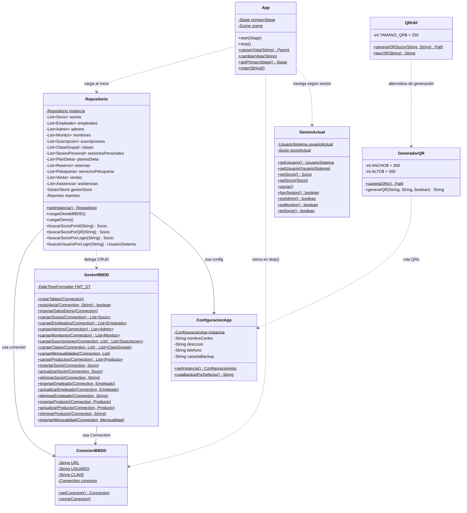

# Diagrama de Clases — Infraestructura (GymPJV)

## Notas de diseño

| Clase | Patrón | Detalle |
|-------|--------|---------|
| `Repositorio` | Singleton | Una sola instancia; carga BD o fallback demo |
| `ConexionBBDD` | Singleton | Conexión estática reutilizable |
| `ConfiguracionApp` | Singleton | Centro, dirección, ruta de backup |
| `SesionActual` | Clase estática | Vars estáticas — solo un usuario/socio logueado |
| `GestorBBDD` | Utilidad estática | Solo métodos `static`; usa `Statement` sin `PreparedStatement` |
| `QRUtil` | Utilidad estática | Genera y lee QR vía ZXing |
| `GeneradorQR` | Servicio | Calcula ruta dinámica y escribe PNG |
| `App` | JavaFX Application | Punto de entrada; gestiona Stage/Scene |
