# Diagrama General de Controladores — GymPJV

```mermaid
flowchart TD
    subgraph ENTRADA["Entrada"]
        IS["InicioSesionController\n(InicioSesion.fxml)"]
    end

    subgraph MENUS["Menús principales"]
        MA["MenuController\n(Menu.fxml)\nAdmin / Monitor"]
        MM["MenuMonitorController\n(MenuMonitor.fxml)\nMonitor — datosEntrada()"]
        MS["MenuSocioController\n(MenuSocio.fxml)\nSocio"]
    end

    subgraph ADMIN["Vistas Admin / Monitor"]
        direction TB
        SOC["SociosController\n(Socios.fxml)\nPatrón Agenda"]
        EMP["EmpleadosController\n(Empleados.fxml)\nPatrón Agenda + datosEntrada"]
        SUS["SuscripcionesController\n(Suscripciones.fxml)"]
        CUO["CuotasController\n(Cuotas.fxml)"]
        CLA["ClasesController\n(Clases.fxml)"]
        ASI["AsistenciaController\n(Asistencia.fxml)"]
        SES["SesionesPersonalesController\n(SesionesPersonales.fxml)"]
        RES["ReservasController\n(Reservas.fxml)"]
        PEL["PeluqueriaController\n(Peluqueria.fxml)"]
        TIE["TiendaController\n(Tienda.fxml)"]
        STK["StockController\n(Stock.fxml)"]
        REP["ReportesController\n(Reportes.fxml)\nBarChart + PieChart"]
        QRG["AccesoQRController\n(AccesoQR.fxml)\nGenerar + Leer QR"]
        CAL["CalculadoraController\n(Calculadora.fxml)"]
        CFG["ConfiguracionController\n(Configuracion.fxml)"]
        BAK["BackupController\n(Backup.fxml)"]
    end

    subgraph SOCIO["Vistas Socio"]
        direction TB
        DAT["DatosSocioController\n(DatosSocio.fxml)"]
        MIS["MiSuscripcionController\n(MiSuscripcion.fxml)"]
        MDI["MiDietaController\n(MiDieta.fxml)"]
        MRE["MisReservasController\n(MisReservas.fxml)"]
        MQR["MiQRController\n(MiQR.fxml)"]
        MHI["MiHistorialController\n(MiHistorial.fxml)"]
    end

    subgraph INFRA["Infraestructura"]
        direction LR
        APP["App.java\ncambiarVista()"]
        SA["SesionActual\nusuario / socio"]
        REP2["Repositorio\nSingleton en memoria"]
        BBDD["GestorBBDD\nStatement / SQL concat"]
        CONN["ConexionBBDD\nMySQL root/2006/gympjv"]
        GQR["GeneradorQR + QRUtil\nZXing"]
        FG["FuncionesGraficas\nAlertas / diálogos"]
    end

    %% Navegación desde login
    IS -->|"Admin → cambiarVista(Menu)"| MA
    IS -->|"Monitor → datosEntrada() + cambiarVista(MenuMonitor)"| MM
    IS -->|"Socio → cambiarVista(MenuSocio)"| MS

    %% Admin carga vistas en BorderPane central
    MA --> SOC & EMP & SUS & CUO & CLA & ASI
    MA --> SES & RES & PEL & TIE & STK & REP & QRG & CAL & CFG & BAK

    %% Monitor carga vistas limitadas
    MM --> CLA & ASI & SOC & SES & RES

    %% Socio carga sus vistas
    MS --> DAT & MIS & MDI & MRE & MQR & MHI

    %% Todos los controladores usan la infra
    MA & MM & MS -.->|"SesionActual"| SA
    SOC & EMP & SUS & CLA & QRG -.->|"Repositorio / GestorBBDD"| REP2
    REP2 -.-> BBDD --> CONN
    QRG -.-> GQR
    SOC & EMP & SUS -.-> FG
```

## Patrones usados

| Patrón | Dónde se aplica |
|--------|----------------|
| **Agenda** (vars estáticas + `contReg`) | `SociosController`, `EmpleadosController` |
| **datosEntrada** (setter estático antes del FXML) | `MenuMonitorController`, `EmpleadosController` |
| **Singleton** | `Repositorio`, `ConfiguracionApp`, `ConexionBBDD` |
| **Session guard** (`initialize` → `SesionActual`) | Todos los controladores de módulo |

## Roles y acceso

| Rol | Menú | Módulos restringidos |
|-----|------|----------------------|
| Admin | `Menu.fxml` | Todos los módulos |
| Monitor | `MenuMonitor.fxml` | Clases, Asistencia, Socios, SesionesPersonales, Reservas |
| Socio | `MenuSocio.fxml` | Datos propios, Suscripción, Dieta, Reservas, QR, Historial |
