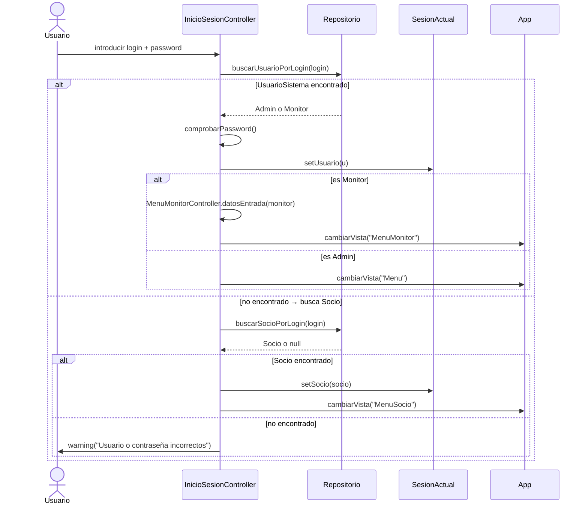
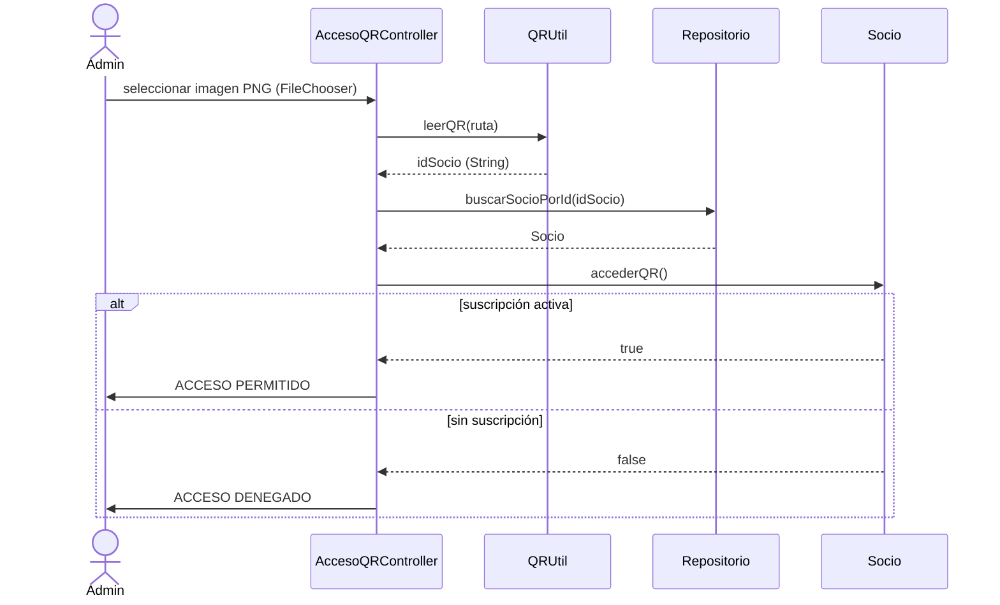

# Diagrama de Flujo General — GymPJV

```mermaid
flowchart TD
    START([Inicio: App.start])
    --> CARGA["Repositorio.getInstancia()\ncargarDesdeBBDD()\n↓ Si MySQL falla → cargarDemo()"]
    --> IS["InicioSesion.fxml\nInicioSesionController"]

    IS --> AUTH{{"¿Credenciales\ncorrectas?"}}
    AUTH -- No --> ERR["FuncionesGraficas.warning\n'Usuario o contraseña incorrectos'""]
    ERR --> IS

    AUTH -- "Sí → Admin o Monitor" --> CHKROL{{"¿Rol?"}}
    AUTH -- "Sí → Socio" --> SESOCIO["SesionActual.setSocio()\ncambiarVista(MenuSocio)"]

    CHKROL -- Admin --> SEADMIN["SesionActual.setUsuario()\ncambiarVista(Menu)"]
    CHKROL -- Monitor --> SEMON["MenuMonitorController\n.datosEntrada(monitor)\ncambiarVista(MenuMonitor)"]

    %% ── MENÚ ADMIN ───────────────────────────────────────────────────────────
    SEADMIN --> MENUADMIN["Menu.fxml\nMenuController\n(BorderPane central)"]
    MENUADMIN --> VISTAS_ADMIN

    subgraph VISTAS_ADMIN["Vistas — Admin"]
        direction LR
        SOC["Socios\n(Patrón Agenda)"]
        EMP["Empleados\n(Patrón Agenda\n+ datosEntrada)"]
        SUS["Suscripciones"]
        CUO["Cuotas"]
        CLA["Clases"]
        ASI["Asistencia"]
        SES["Sesiones Personales"]
        RES["Reservas"]
        PEL["Peluqueria"]
        TIE["Tienda"]
        STK["Stock"]
        REP["Reportes\n(BarChart+PieChart)"]
        QRV["Acceso QR\n(Generar/Leer)"]
        CAL["Calculadora"]
        CFG["Configuración"]
        BAK["Backup"]
    end

    %% ── MENÚ MONITOR ─────────────────────────────────────────────────────────
    SEMON --> MENUMON["MenuMonitor.fxml\nMenuMonitorController"]
    MENUMON --> VISTAS_MON

    subgraph VISTAS_MON["Vistas — Monitor (limitadas)"]
        direction LR
        MCLA["Clases"]
        MASI["Asistencia"]
        MSOC["Socios (solo lectura)"]
        MSES["Sesiones Personales"]
        MRES["Reservas"]
    end

    %% ── MENÚ SOCIO ───────────────────────────────────────────────────────────
    SESOCIO --> MENUSOC["MenuSocio.fxml\nMenuSocioController"]
    MENUSOC --> VISTAS_SOC

    subgraph VISTAS_SOC["Vistas — Socio"]
        direction LR
        SDAT["Mis Datos"]
        SSUS["Mi Suscripción"]
        SDIET["Mi Dieta"]
        SRESV["Mis Reservas"]
        SQR["Mi QR"]
        SHIST["Mi Historial"]
    end

    %% ── CAPA DE DATOS ────────────────────────────────────────────────────────
    VISTAS_ADMIN & VISTAS_MON & VISTAS_SOC --> REPO

    subgraph REPO["Capa de datos"]
        direction LR
        REP2["Repositorio\n(listas en memoria)"]
        GBBDD["GestorBBDD\n(Statement + SQL concat)"]
        CONN["ConexionBBDD\n(MySQL root/2006/gympjv)"]
        GQR2["GeneradorQR / QRUtil\n(ZXing)"]
        REP2 --> GBBDD --> CONN
    end

    %% ── CIERRE DE SESIÓN ─────────────────────────────────────────────────────
    MENUADMIN & MENUMON & MENUSOC --> LOGOUT["SesionActual.cerrar()\ncambiarVista(InicioSesion)"]
    LOGOUT --> IS

    %% ── CIERRE DE APP ────────────────────────────────────────────────────────
    LOGOUT -.-> STOP
    START -.-> STOP([App.stop\nConexionBBDD.cerrarConexion])
```

## Flujo de autenticación (detalle)



## Flujo de acceso con QR (detalle)


